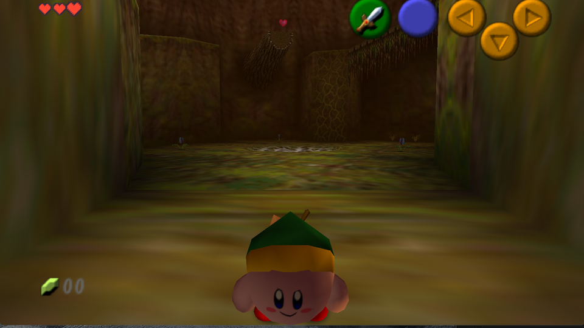
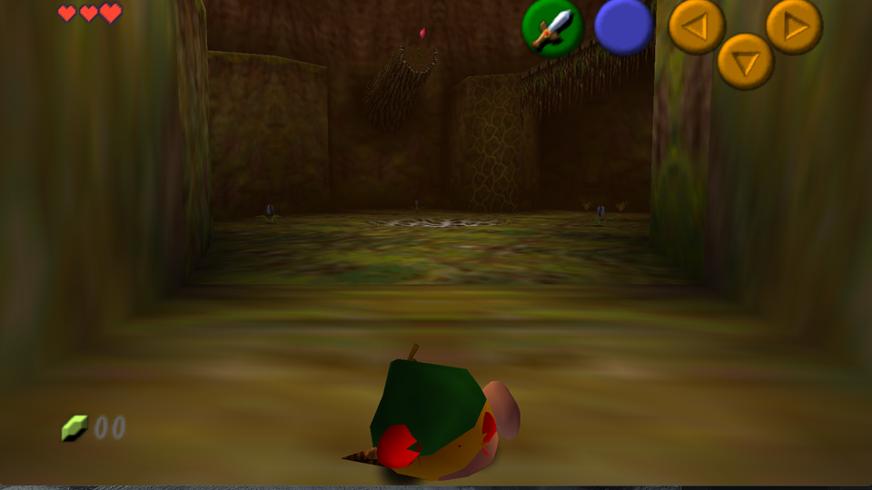
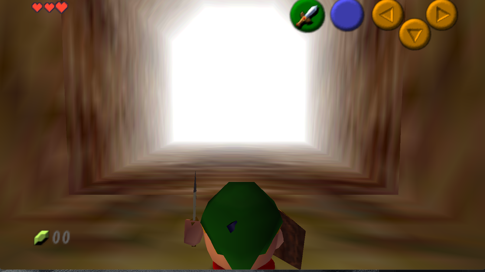

# Sword of Harkinian

Sword Kirby as the player character in The Legend of Zelda: Ocarina of Time, running on
[Ship of Harkinian](https://github.com/HarbourMasters/Shipwright).

Kirby's sword ability is already Link in everything but shape: he wears the green cap
and swings a blade. Ocarina of Time's player skeleton turns out to meet him most of the
way, because the cap and the sheathed sword are each their own bone. The costume is
mostly a matter of replacing the ball underneath.

## Status

He plays. Both ages pack into one `.o2r` archive each that Ship of Harkinian 9.3.0 loads
from its `mods` folder, with the sheathed sword and shield on the back of the ball, the
sword held blade up beside him, the shield at his side when raised, mittens on every empty
hand, and the pause screen's Equipment page posed to match.

| Piece | State |
| --- | --- |
| Link's limb table, derived from extracted game data | Done, and verified against the real import |
| Asset extraction from the ROM | Done, `decomp/extracted/ntsc-1.2` |
| Fast64 skeleton import of both ages | Done, 21 bones, table agrees |
| Sword Kirby, assembled and rigged to the real skeleton | Done, 490 vertices, 706 triangles |
| Packing into an `.o2r` the port reads from `mods` | Done, `tools/make_mod.py` |
| Every player animation re-posed for his arms, legs and sheath | Done, `tools/carry_fk.py` |
| Running it in Ship of Harkinian 9.3.0 on Windows (DirectX 11) and macOS (Metal) | Done |





## Installing the mod

1. Build the archives (below) or take them from a release.
2. Copy `kirby_child.o2r` and `kirby_adult.o2r` into Ship of Harkinian's `mods` folder,
   beside its `oot.o2r`.
3. Start the game. Nothing to enable; the archives replace Link's model, hands, sheath
   and animations by name, and removing them puts him back.

`kirby_voice.o2r` is optional and gives him Kirby's voice from Super Smash Bros.; see
`tools/kirby_voice_map.py`. It needs your own copy of that ROM to build.

## Getting him into the game

Ship of Harkinian loads custom assets from `.o2r` archives in its `mods` folder. An
archive is a zip; a file at `alt/<path>` replaces the game's own resource at `<path>`,
and the port reads XML display lists, vertex lists, textures and materials, so the whole
mod is generated text plus the animation data. `tools/make_mod.py` writes it straight
from the rigged Blender file; no ROM build and no retro.

Two things about the port decide the shape of the mod, both found the hard way. Its Metal
backend crashes on any skeleton limb served from a mod, so nothing here moves a joint;
every change of pose is done in the animation data instead (`tools/carry_fk.py`), which
ships under names of its own with only the animation headers overridden. And the port
names vertex arrays by ROM offset, not by the decompilation's names, so vertex lists ship
under the archive's names (`tools/check_archive.py` lists anything the game would not
read). The rest of this file is the long form.

## Where Kirby comes from

No single game ships this character, so he is assembled from three N64 models. None of
them is committed here; `blender/build_sword_kirby.py` rebuilds him from your own copies,
which you can fetch from The Models Resource.

| Part | Source | Triangles | Why |
| --- | --- | --- | --- |
| Body, face, feet | Kirby 64: The Crystal Shards, asset 292078 | 516 | Roughly double the resolution of the Smash 64 Kirby, with a far better face |
| Link's cap | Super Smash Bros., asset 283456 | 48 | The only N64 Kirby wearing it, cut out by its green cloth and gold fringe textures |
| Sword | Kirby 64 Burn-Cutter Sword, asset 533304 | 34 | Smash 64's Link Kirby carries a boomerang, wrong for a character replacing the Master Sword |

That totals 598 triangles against Adult Link's budget of roughly 1400, and every texture
is already 64x64 or smaller, inside the cap Fast64's guide sets.

An earlier version of this model was generated from spheres and cones by script. It is
gone: a flat-shaded ball with 3D lumps for eyes reads as a pink blob, and the ripped
models carry proper face textures, which is also what the format wants, since Link's eyes
and mouth are flipbook textures.

### Extracting the assets

The extractor is mostly Python, but it loads `tools/assets/n64texconv`, a C shared
library, so it needs a compiler. On a machine without one, build and extract elsewhere
and copy `extracted/ntsc-1.2` back. On macOS the shared library may fail to link against
a default SDK newer than the installed command line tools; pass a matching one:

```bash
clang -isysroot /Library/Developer/CommandLineTools/SDKs/MacOSX26.sdk \
  -shared -o libn64texconv.so $(find build -name '*.o') -lz -lm
```

## What you need

Ship of Harkinian does not ship any copyrighted material and neither does this
repository. You supply your own Ocarina of Time ROM, the same way Ship of Harkinian
itself requires one. This project is built against the US v1.2 ROM, which the
decompilation calls `ntsc-1.2`.

| Tool | Version | Note |
| --- | --- | --- |
| Blender | 4.5 | Fast64 supports 3.2 up to 5.1.2 and recommends 4.0 or newer. Blender 5.2 is too new. |
| Fast64 | upstream `main` | The HarbourMasters fork is Banjo-Kazooie work and has no Ship of Harkinian code. |
| retro | 0.2.1 | Builds the o2r archive. |
| Ship of Harkinian | 9.3.0 | Dewey Alpha, released 6 October 2026. |
| Ocarina of Time decompilation | zeldaret/oot | Fast64's import and export target. Never committed here. |

`tools/setup.ps1` stages all of these into `.toolchain/` and clones the decompilation
into `decomp/`. Both directories are ignored by git.

## Build

Build the model and check that every limb carries geometry:

```powershell
& 'C:\Program Files\Blender Foundation\Blender 4.5\blender.exe' --background `
  --python blender/sword_kirby.py -- --out build/sword_kirby.blend
```

Render the preview sheets:

```powershell
& 'C:\Program Files\Blender Foundation\Blender 4.5\blender.exe' --background `
  --python blender/render_preview.py -- --out docs/preview
```

The limb-ownership renders recolour every triangle by which of Link's limbs owns it.
That is the picture to check before any export, because a limb left with no geometry is
obvious there and invisible in a normal render.

## How the costume works

Three things about Ocarina of Time's player skeleton shape this model, and all three
come from the decompilation or from Fast64's own guide rather than from guesswork.

**Twenty-one limbs, three of which must not deform.** The limb list and its order come
from `object_link_boy.xml`, and the names from the `PlayerLimb` enum. Fast64 requires
that the root, upper control and lower control bones are the only non-deform bones,
which leaves eighteen that deform. `blender/link_skeleton.py` holds that table and
asserts both facts at import time.

**Every deforming limb needs geometry.** Fast64's guide is explicit that Link's actor
breaks if a deformable bone has nothing weighted to it. Kirby has no thighs, shins or
shoulders, so those three pairs get small wedges hidden inside the body. They satisfy
the exporter and the actor without ever being seen. The generator fails loudly if any
limb ends up empty.

**Rigid weights are correct here, not a shortcut.** Link is a flex skeleton of LOD
limbs, so the game draws one display list per limb. A vertex weighted across two limbs
has nowhere to go. The body ball is therefore split into whole horizontal rings handed
out to the waist, torso, collar and head.

The head deliberately takes the largest share of the ball. Kirby's face sits around its
middle, and it has to belong to the head limb or he will not turn to look at anything,
because the head bone is what the game aims during Z-targeting and cutscenes.

Two limbs do the costume almost by themselves. The cap goes on `PLAYER_LIMB_HAT`, which
already trails behind the head, and the sword rides `PLAYER_LIMB_SHEATH` on his back. A
held sword lives in the hand mesh, so a mitten inherits the grip.

## How he is rigged

`rig_to_link.py` weights Kirby against the skeleton Fast64 imported from the
decompilation, not against his own bounding box. Each piece is identified by what it is,
carried from assembly as a role tag, and then matched to the nearest real bone of a
plausible set, measured to the bone segment rather than to its head. The feet find Link's
foot bones, the mittens find his hands, the sword goes with the hand that holds it.

The body ball is the exception, and it is worth saying why rather than pretending the
rule is uniform. Kirby has no neck. Splitting the ball across Link's spine tears him in
half the moment those bones rotate, because the weights are rigid and nothing blends
across the seam. A 55 degree head turn separated his crown from his face entirely. So
the whole ball rides the single spine bone whose pivot sits nearest the ball's centre,
which turns out to be the torso. The cap has to ride that bone too: Link's hat bone is a
child of his head, so leaving the cap there would swing it off a ball that no longer
follows the head.

The cost is that Kirby does not turn his head independently during Z-targeting. For a
character who is one sphere that is the right trade, since a ball swinging off a pivot
near its crown looks far worse than a ball that does not glance sideways.

The mittens are the exception the other way: they sit exactly on Link's hand joints,
which is only sane because the animations keep those joints beside him (see below).

Limbs Kirby has nothing to give, the thighs, shins, shoulders and sheath, get a small
wedge hidden inside the body at the real bone, pulled in toward the centre so it stays
buried. Link's actor misbehaves if a deformable bone has nothing weighted to it.

The sheathed sword and shield are the game's own, moved rather than redrawn: every
`*Sheath*Vtx*` list is scaled to Kirby's height, pushed straight back until it clears
the back of the ball, and centred on the ball's middle, so the Deku shield rests on his
back instead of on the hat and the pause menu's Equipment page no longer draws it across
his face. The measurement is made in the game's standing idle through the same limb walk
the game uses (`carry_fk.idle_pose`), not in Blender's rest pose, whose sheath limb sits
a quarter turn and most of a body height away from where the idle puts it.
The sheath limb is also held at the idle's rotation in every frame of every animation:
Link's animations swing it through 284 of the 573, which on his back reads as the
scabbard shrugging, but Kirby's set sits a ball away from that joint and swung out beside
him in turns. The torso limb never rotates, so the pinned set stays on the ball.

The shield hand keeps Link's own world orientation while the shield is up and while
the sword is drawn (`carry_fk.keep_hand`): the game draws a held thing by the hand's
orientation, and aiming that hand at its mitten target had turned the raised Deku shield
over. A hand that keeps Link's orientation cannot hang its load along its x, because in
the guard that x points up and away and the shield sat over his head; so the shield
lists hang along the direction that, in Link's guard pose, runs from the joint toward
the flank (`carry_fk.shield_hang`, close to minus x), and the shield hand's joint is
placed for that hang. The guard is then exactly reachable and the drawn-sword stance is
short by a third of a unit at worst. Every other hand hangs its load the same way the sword hand does, a hang BEFORE the
joint along the hand's x, and is placed the same way: the joint a hang above the mitten's
spot with the hand's x pointing up, which Link's arm reaches from a shoulder above the
cap. One convention for every hand list is forced by the game itself: the guard plays
`link_normal_defense_wait` whether the sword is out or sheathed, drawing the sword list
in one case and the closed fist in the other, so the two cannot hang in opposite
directions, and the earlier split (sword lists one way, everything else the other) put
the sheathed guard's fist 2.6 units up the arm, over his head.

Link's hand textures are palette-indexed (CI8), so the skin cannot go in as an RGBA16
image: the game reads pink pixel bytes as palette entries and the fist comes out in
stripes. Each hand texture ships as a one-entry fill and each hand-only palette ships all
pink (`mitten_hands.hand_textures`); the adult gauntlet palette is shared with the back
sheath, so it is left alone and the gauntlets take its nearest pink.

## Carrying a pot

The game places a carried pot or bush halfway between Link's two hand limbs, which on a
character two thirds his height is a body height over the cap. The fix is in the carry
animations: `tools/carry_fk.py` poses both arms in every frame of the pickup, the holding
loop and the bush pull so that each hand lands where a shoulder lowered by
`SHOULDER_DROP` would have put it, through the same limb walk the game uses. Nothing of
Kirby's is drawn on the arm limbs, so the pose can be anything and only the pot moves.
`SHOULDER_DROP` in `tools/make_mod.py` is the one number to tune.

It used to be done by lowering the two shoulder joints in the skeleton limb resources,
which is exact and crashes Ship of Harkinian's Metal backend on every scene transition:
any skeleton limb served from a mod archive does, even one identical to the game's own.
The build therefore ships no limb resources at all, and the same archives run on Windows
and macOS.

## Animations ship under their own names

Ship of Harkinian 9.3.0 draws the player wrong, tipped, sunk or not at all, for a frame or
two at every animation change when the animation data comes from a mod archive in place of
the game's own blob, whatever the bytes: a blob copied unchanged into `alt/` at its own
path reproduces it. So the build never overrides animation data. Each rewritten blob goes
under `misc/link_animetion/kirby/<name>`, a path the base game has no twin of, and only
the small `LinkAnimationHeader` that names it is overridden, with its segment string
pointing at the copy. `docs/preview/walkbisect/` holds the nine runs that found it.

## His feet are Link's foot joints too

The shoes ride Link's foot limbs, which swing on his leg arcs, far wider than Kirby is:
a slash kicked a shoe up to his ear and a run threw one through his back. Every
non-riding animation now poses both legs the way the arms are posed: each foot joint goes
to its place in the standing idle plus `FOOT_REACH` (0.3) of where Link's foot went,
thigh and shin solved per frame, and the foot keeps Link's world rotation so the shoe
pitches through the step as his boot does. The riding set keeps Link's legs.

## How he holds the sword

The closed and raised hand variants the game swaps in while running and guarding draw
Link's fist in Kirby's skin, the same hand as on a held item. They were stubbed to nothing
for a while (a variant that drew the open mitten had put a pink disc over the held grip),
and that made both hands vanish whenever the shield came up; `--hide-hands` brings the
stubs back.
`tools/mitten_hands.py` balls the fist on a held item at Link's own fist reach, centred on
the grip, and hangs a sword's list the other way round so the blade runs up through the
joint. The pause menu's Equipment page is the front view used to check all of this.

Which animations count as sword-drawn comes from the game's own table, not from their
names: `link_normal_wait` is the drawn idle and `link_normal_wait_free` the hands-free one.
`SWORD_DRAWN` in `tools/carry_fk.py` is columns 1 to 3 of that table minus the names it
also plays hands-free.

The sword hand is held higher than the mitten's place on the ball and pushed out by the
fist's radius (`SWORD_RAISE`, `SWORD_OUT` in `tools/carry_fk.py`), with the hand turned
so the blade points up and a little forward (`REST_BLADE`). The blade is square to the
hang, and Link's shoulder sits two body units above Kirby's mitten, so a level hang is out
of reach; the solver takes the most level hang the arm reaches each frame, which lands the
blade about thirty degrees from vertical on both skeletons. Attacks keep Link's own blade
direction, eased in over four frames, so a slash sweeps as authored. The empty hand stays
on its flank like any other pose.

## His arms are Link's hand joints

Kirby's mittens ride Link's hand joints, with no offset, so the left one holds the
sword and both of them hold a pot. That only works because every one of the game's 573
player animations is rewritten so the hand joints stay beside his body: `all_animations`
in `tools/carry_fk.py` poses both arms in every frame through the game's own limb walk.
The carry set puts the hands where they hold the pot at his middle; the riding set is
shifted onto the saddle as well; everything else gets a stubby reach, each hand anchored
near where his mitten belongs on the ball and moving by `SWING_REACH` of Link's own
shoulder-to-hand vector, with the hand's world rotation restored so a held sword still
points where the animation meant. Link's shoulder sits above Kirby's cap and his arm is
shorter than the drop to the flank, so the anchor is as far down that line as the arm
reaches (`ANCHOR_FRACTION`). The pass takes about seven minutes per age in pure Python
and is cached in `build/` against every number that went into it.

With an item in hand the game draws its own hand-and-item list at the joint, so the hand
on the hilt is Link's fist, in Kirby's skin: `tools/mitten_hands.py` replaces the hand
textures with it. The same script also writes vertex lists that ball the fist on the
joint, but those go out under the decompilation's names, which the game archive does not
use for vertex arrays (it names them by offset, `object_link_childVtx_00AF50`). Since
14 October every hand list, held item and closed hand alike, ships under the archive's
name as well. An empty hand, open, closed or raised, is the mitten at the mitten's
size; a hand with something in it is a pink ball centred where Link's fist was: on a
sword's hilt two thirds of the mitten's size (`SWORD_HAND` in `tools/mitten_hands.py`;
the fist's own size floated off the body and the mitten's swallowed the hilt), and the
fist's size behind a shield so nothing pokes out through it (`--fist-hands` keeps Link's
own fist there instead). A hand's travel from its spot is a fifth of Link's arm motion, capped at
half the mitten's radius, so the mittens stay against the body.

The pause screen's Equipment page plays no animation: the game copies a fixed joint
table into the skeleton (`gLinkPauseChildDekuShieldJointTable` and its kin). Those
tables are posed the same way as a frame of the drawn-sword rest and shipped under
`alt/objects/gameplay_keep/`, so the hung mittens and the moved sheath sit where they
belong on that page too.

### Checking it

`pose_test.py` poses the skeleton and renders, because a rest pose says nothing about
rigging. Each pose checks one thing that would be wrong in the game:

```powershell
& 'C:\Program Files\Blender Foundation\Blender 4.5\blender.exe' --background `
  --python blender/pose_test.py -- --blend build/sword_kirby_rigged.blend --out docs/preview/pose
```

| Pose | Proves |
| --- | --- |
| Head turned | He does not tear at a seam |
| Sword arm raised | The blade travels with the hand instead of hanging in the air |
| Legs swung apart | His feet move while the ball stays put, which is what walking looks like |

## Layout

| Path | Holds |
| --- | --- |
| `blender/link_skeleton.py` | Link's limb table, and a check against a real import |
| `blender/import_link_skeleton.py` | Imports Adult Link with Fast64 and verifies the table |
| `blender/build_sword_kirby.py` | Assembles Kirby from the three ripped models |
| `blender/rig_to_link.py` | Weights him to the real skeleton |
| `blender/pose_test.py` | Poses the skeleton to prove the weights follow |
| `blender/render_preview.py` | Preview and limb-ownership renders |
| `tools/make_mod.py` | Packs the rigged model into the mod archive. Run in Blender. |
| `tools/check_archive.py` | Lists every entry in a packed archive that the game will not read: no twin in `oot.o2r` and no reference from the mod's own lists. Run after every pack. |
| `tools/carry_fk.py` | Poses the arms in the carry and sword animations through the game's own limb walk |
| `tools/mitten_hands.py` | Balls the game's hand into a mitten on every list that holds an item |
| `docs/preview/` | Rendered previews |
| `mod/` | The o2r contents |
| `decomp/` | The decompilation. Ignored by git, never committed. |
| `.toolchain/` | Staged third-party tools. Ignored by git. |

## Doing this again, for something else

What was learned here is written up as a reusable skill at
`C:\GitHub\.claude\skills\ship-of-harkinian-models`, with working copies of the
generator, the axis calibration, the limb parser and a PowerShell driver for the game.
It carries the parts that cost the most to find: that a model mod needs no ROM, what the
archive actually contains, which facts have to be derived rather than guessed, and the
N64 limits a model has to fit.

Third-party tools and references are credited in [CREDITS.md](CREDITS.md).
